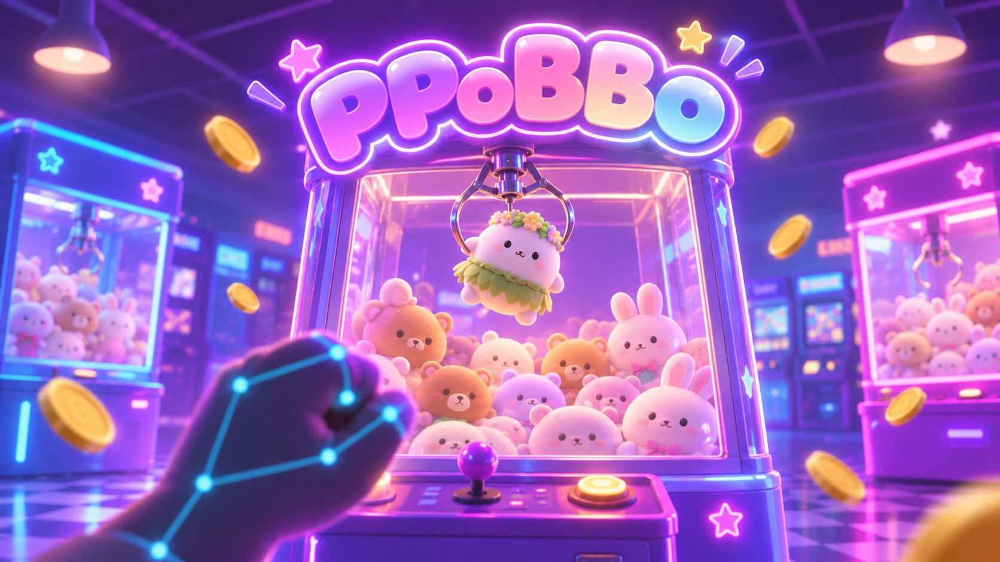

# 🕺 Team DooDoomChit · 두둠칫

**손짓 한 번에 두둠칫! 웹캠 앞에서 즐기는 3D 인형뽑기 오락실을 만듭니다.**

---

## 🧸 PPoBBo (뽑뽀)

> 밤 늦은 네온 오락실, 버튼 대신 **손동작**으로 집게를 조종해 인형을 뽑고 나만의 인형 도감을 채워 가는 모션 인식 3D 인형뽑기 게임

| ✋ 손으로 조작 | 🕹 진짜 같은 기계 | 📖 모으는 재미 |
| :---: | :---: | :---: |
| 웹캠만 있으면 끝! 주먹 쥐고 기울이면 집게가 움직이고 손바닥으로 누르면 집게가 내려가요 | 물리 엔진으로 인형이 쌓이고 미끄러지는 3D 오락실과 인형뽑기 기계 세 대 고개를 돌려 기계 주위를 둘러봐요 | 뽑은 인형은 도감에 차곡차곡 360° 뷰어로 돌려 보고 출석·야간 근무로 골드를 모아요 |

### 🎮 이렇게 놀아요

| 동작 | 결과 |
| --- | --- |
| 👌 OK 사인 | 코인 넣기 |
| ✊ 주먹 쥐고 기울이기 | 집게 이동 (펴면 멈춤) |
| 🖐 손바닥을 아래로 누르기 | 집게 내리기 |
| 🙂 고개 돌리기 / 🖱 마우스 드래그 | 시점 돌리기 |

카메라가 없어도 키보드(방향키 · Space · C)와 마우스로 플레이할 수 있어요.

---

## 🛠 Tech Stack

| 파트 | 기술 |
| --- | --- |
| 3D 그래픽 · 물리 | Three.js, cannon-es |
| 모션 인식 | MediaPipe Hands · Face Landmarker (웹캠, 브라우저에서 바로 실행) |
| 게임 로직 · 저장 | Vanilla JS, LocalStorage |
| 빌드 · 테스트 | Vite, Node.js 내장 테스트 러너 |

---

## 👥 Members

|  |  |
| :---: | :---: |
| **김수빈** | **이효은** |
| [@sooooooobinn](https://github.com/sooooooobinn) | [@hyooeunn](https://github.com/hyooeunn) |
| 🎨 3D 그래픽 · 물리 · UI | 🤖 모션 인식 · 게임 로직 |
| 오락실과 기계, 인형 모델 집게 물리, 화면과 모달 | 손·얼굴 인식, 손동작 → 집게 조작 골드 · 출석 · 야간 근무 · 도감 |

---

## 🌿 How We Work

- **Git Flow**: `main` ← `develop` ← `feature/#이슈-작업명` · `fix/#이슈-작업명`
- **이슈 → 브랜치 → PR → 리뷰 → 머지**: 모든 작업은 이슈로 시작하고, 서로 코드 리뷰를 거쳐 승인된 PR만 머지해요.
- **커밋**: `<type>: <설명> (#이슈)` · 작은 단위로 나눠서
- **연동 규약**: 모션 입력 ↔ 3D·UI 사이 약속은 [`docs/INTEGRATION.md`](https://github.com/Team-DooDoomChit/PPoBBo/blob/develop/docs/INTEGRATION.md)에 정리

 

**🪙 코인 하나 넣고, 손 한 번 흔들어 보세요!**

